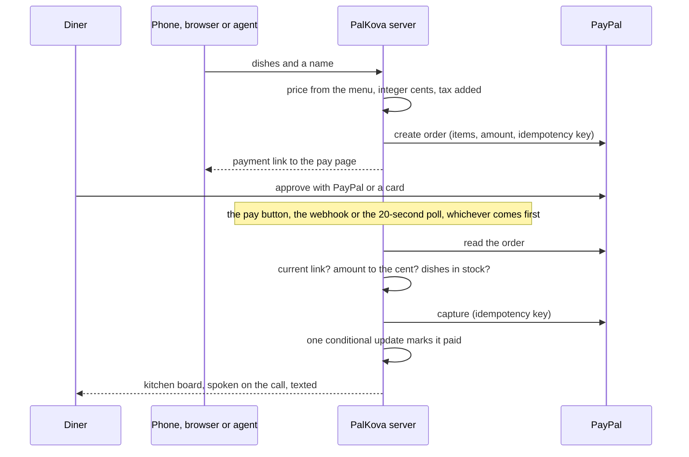
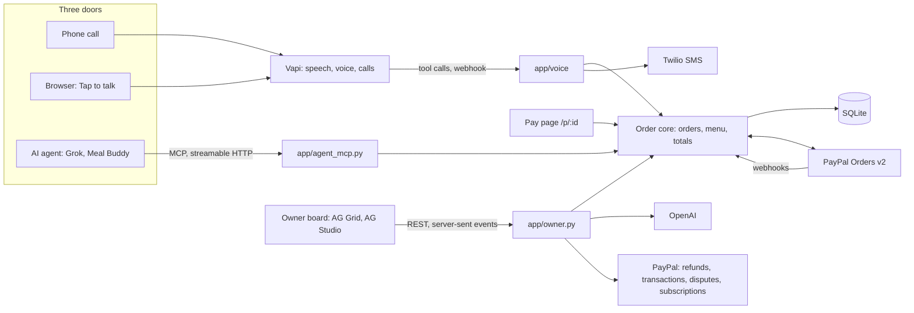

# PalKova

**An ordering line that makes a restaurant agent-ready.** Callers, web visitors and anyone's AI agent order from one engine. The server prices every order, PayPal takes every payment, and no agent can spend a cent on its own.

PalKova runs one restaurant today: **Kaveri Kitchen**, a fictional Indian pickup counter with 31 dishes. All payments run in the PayPal sandbox. No real food, no real money.

Built for the PayPal AI Hackathon.

- **Live demo:** https://palkova.hariths.com
- **Call the line:** (350) 250-3546
- **MCP endpoint:** `https://palkova.hariths.com/mcp`

## Contents

1. [What it does](#1-what-it-does)
2. [Try it](#2-try-it)
3. [How a payment stays safe](#3-how-a-payment-stays-safe)
4. [Architecture](#4-architecture)
5. [PayPal, AG Grid and APIMatic in the code](#5-paypal-ag-grid-and-apimatic-in-the-code)
6. [Connect an AI agent](#6-connect-an-ai-agent)
7. [Run it locally](#7-run-it-locally)
8. [Configuration](#8-configuration)
9. [Deploy](#9-deploy)
10. [Limits of the demo](#10-limits-of-the-demo)
11. [License](#11-license)

## 1. What it does

One order engine sits behind three doors.

| Door | How it works |
|---|---|
| **Phone** | Call the number and order by voice. The agent reads the order back with the server's total, asks for a name, and, with the caller's permission, texts a link to the pay page. Pay while still on the call, and the agent says the payment arrived. |
| **Browser** | *Tap to talk* on the restaurant page starts the same conversation. The ticket fills in as you speak, and the PayPal buttons appear on it the moment the order is placed. |
| **AI agents** | Any assistant that speaks MCP can search the menu, place an order and hand its user a payment link. The agent sees no card and no login. |

All three end on the same pay page. Pay with a PayPal account, or with a debit or credit card through PayPal's own card form, with no PayPal account at all. Card details go to PayPal, not to the restaurant.

Behind the counter, the owner gets:

- **A live kitchen board.** Paid orders arrive the moment they are paid, what needs cooking first, with ready-by times and one-tap status changes.
- **A menu and stock grid.** Price, spice and daily par per dish, with sales by hour. When a dish runs out, it leaves the phone menu, the web page and agent searches at once.
- **An Ask bar on both grids.** Plain English filters the grid ("paid orders over $40"), answers takings and sales questions, and proposes refunds. The AI can find a refund. Only the owner's tap can make one, and the server re-checks it first.
- **Takings.** A dashboard of the last 90 days of paid orders, with a kitchen analyst agent that answers from the data and can add charts to the page.
- **A subscription switch.** The restaurant pays for the line with a PayPal subscription (7-day trial, then $99 a month). Cancel it, and all three doors stop taking orders.

PayPal on both ends: diners pay the restaurant, and the restaurant pays for the line.

## 2. Try it

| What | Where |
|---|---|
| Order by voice in the browser | https://palkova.hariths.com, then *Tap to talk* |
| Order by phone | (350) 250-3546 |
| Pay | On the pay page, tap *Debit or Credit Card* and use the sandbox test card printed there. No PayPal account needed. |
| Order from Grok | Add `https://palkova.hariths.com/mcp` as a connector at grok.com, then ask for a dish. |
| Owner board | https://palkova.hariths.com/owner. Judges get the password with the Devpost submission. |

[`examples/meal_buddy/`](examples/meal_buddy/) is a proactive agent built on the MCP endpoint alone: a Discord bot that messages you at meal times, suggests dishes, orders through Grok and tells you when the order is paid. It contains no PalKova code.

## 3. How a payment stays safe

A payment link that takes the money first and checks afterwards turns a mistake into a refund. PayPal Orders v2 separates the buyer's approval from the merchant's capture, and PalKova does its checks in between.



1. **One place captures money.** [`capture_if_current`](app/orders.py) is the only function that captures. The pay page, the `CHECKOUT.ORDER.APPROVED` webhook and a background poll all call it.
2. **It checks before it captures.** The PayPal order must be the order's current one, so a link from an order that changed cannot be charged. PayPal's approved amount must equal the server's total to the cent. Each dish must still be in stock, or the order is cancelled before anyone pays.
3. **It checks after, too.** If the captured amount still differs, the order is not marked paid. The kitchen board raises an alert, and the capture id is kept for a refund in PayPal.
4. **One winner.** Three triggers can race for one payment. The order is claimed as `capturing` before money moves, captures carry an idempotency key, and a conditional update decides who reports it, so the kitchen and the diner hear about it once.
5. **Interrupted captures recover.** A capture that never reported back is re-read from PayPal and finished, or released, by the poll. Refunds and reversals arrive by webhook and flag the order on the board.
6. **Agents get a link, not a wallet.** `create_order` returns a `payment_url`. A person opens it and pays. No tool accepts card data, and the voice agent does not ask for it.

We attacked this in the sandbox: a $41.11 order rewritten to $1.00 at PayPal, once before approval and once after. The server refused to capture both times, and no money moved.

## 4. Architecture



- **One service.** FastAPI serves the API, the voice webhook, `/mcp`, the owner's live events and the built React app, from one Docker image. SQLite in WAL mode holds orders, the menu and the subscription.
- **Money lives in the order core.** [`app/totals.py`](app/totals.py), [`app/menu.py`](app/menu.py) and [`app/orders.py`](app/orders.py) price, place and capture. Amounts are integer cents end to end. The doors are thin adapters over the same functions, and route handlers validate input and call the core.
- **The model never handles money.** The voice agent builds a cart with `set_order` and places it with `place_order`. The total it speaks comes from the tool's result, spelled out in words.
- **Voice.** On each inbound call Vapi asks the server for an assistant. The server checks the subscription and the call limits, then returns the prompt with today's orderable menu, the tools, and Deepgram nova-3 speech-to-text with the dish names as key terms. Tool calls come back to a webhook guarded by a shared secret. In the browser, the server creates the call itself, so no voice key reaches the page.
- **Stock.** Each dish has a daily par. Paid orders, and captures still in flight, count against it. A dish at zero drops off every menu.

### Repository map

| Path | What it holds |
|---|---|
| [`app/main.py`](app/main.py) | App assembly, pay routes, PayPal webhook route, background poll |
| [`app/orders.py`](app/orders.py) | Placing, superseding, capturing, expiring and refunding orders |
| [`app/menu.py`](app/menu.py), [`app/totals.py`](app/totals.py) | Menu, stock, dish-name matching, line validation and totals |
| [`app/paypal.py`](app/paypal.py) | The one PayPal client: Orders, Payments, Subscriptions, Transaction Search, webhook verification |
| [`app/webhooks.py`](app/webhooks.py), [`app/subscription.py`](app/subscription.py) | Verified, deduplicated webhooks and the subscription gate |
| [`app/agent_mcp.py`](app/agent_mcp.py) | The MCP server and its three tools |
| [`app/voice/`](app/voice/) | Vapi adapter, voice tools, prompt and call limits |
| [`app/owner.py`](app/owner.py), [`app/command.py`](app/command.py), [`app/studio.py`](app/studio.py) | Owner login and API, the Ask bar, the Takings agents' relay |
| [`app/sms.py`](app/sms.py), [`app/events.py`](app/events.py), [`app/notify.py`](app/notify.py) | Texts, live events, and who hears about a payment |
| [`web/src/`](web/src/) | React app: restaurant page, pay page, owner board, Takings |
| [`config/`](config/) | Restaurant name, tax rate and ready time, and the menu |
| [`scripts/setup_paypal.py`](scripts/setup_paypal.py) | One-time PayPal setup: product, billing plan, webhook |
| [`examples/meal_buddy/`](examples/meal_buddy/) | The Discord agent that orders over MCP |

## 5. PayPal, AG Grid and APIMatic in the code

### PayPal

| PayPal API | Used for | Where |
|---|---|---|
| Orders v2 | Create (items, tax breakdown, idempotency key), read and capture every order | [`app/paypal.py`](app/paypal.py), [`app/orders.py`](app/orders.py) |
| JavaScript SDK | PayPal buttons and the card form on the pay page and the order ticket | [`web/src/components/PayPanel.tsx`](web/src/components/PayPanel.tsx) |
| Webhooks | Approvals, completed, denied, reversed and refunded captures, and subscription changes. Signature-verified and deduplicated. | [`app/webhooks.py`](app/webhooks.py) |
| Payments | Full refunds, only after the owner confirms on screen | [`app/owner.py`](app/owner.py) |
| Subscriptions | The restaurant's plan for the line, its gate, sync and cancel | [`app/subscription.py`](app/subscription.py), [`web/src/components/SubscriptionPanel.tsx`](web/src/components/SubscriptionPanel.tsx) |
| Transaction Search | Takings questions in the Ask bar | [`app/paypal.py`](app/paypal.py), [`app/command.py`](app/command.py) |
| Agent Toolkit | Dispute questions in the Ask bar, read-only | [`app/command.py`](app/command.py) |

The Ask bar sees trimmed PayPal results: amounts, dates, statuses and ids, with no payer names, emails or addresses.

### AG Grid

- **Kitchen board** ([`KitchenBoard.tsx`](web/src/components/KitchenBoard.tsx)): master/detail rows for line items, server-sent events applied as async transactions, and column sets per width band from desktop down to phone.
- **Menu and stock** ([`MenuGrid.tsx`](web/src/components/MenuGrid.tsx)): editable price, par and spice, an on-menu switch, sparklines of sales by hour, and range charts themed to the board.
- **AI Toolkit** ([`CommandBar.tsx`](web/src/components/CommandBar.tsx), [`app/command.py`](app/command.py)): the grid's structured schema and current state go to the server. The model returns a new state under that schema in strict mode, the server validates it, and the grid applies it. The model sees the schema and the state, not the rows.
- **AG Studio** ([`Takings.tsx`](web/src/components/Takings.tsx), [`web/src/studio/`](web/src/studio/)): the Takings dashboard, themed from the board's own tokens, with one widget of our own, *Ordered together*, that counts the dish pairs found in the same order. On the Agent Framework, our kitchen analyst agent answers from the data and hands changes to the page to Studio's lead agent. Its `ordered_together` tool runs the widget's own counting, so the two agree. Each agent turn goes through our server ([`app/studio.py`](app/studio.py)), which holds the key, picks the model and caps the output. The data carries no customer names.

### APIMatic

[`app/paypal.py`](app/paypal.py) is built on PayPal's Server SDK for Python, `paypal-server-sdk` 2.4.0, generated by APIMatic. Every PayPal call the SDK covers goes through it: reading and capturing orders, refunds, subscriptions, the billing plan and Transaction Search. Two calls stay on plain REST because the SDK lacks them: creating an order, whose experience context has no `app_switch_preference` (the field that keeps a sandbox payer in the browser on a phone with the PayPal app installed), and webhook signature verification.

## 6. Connect an AI agent

Add `{PUBLIC_BASE_URL}/mcp` as a remote MCP server (streamable HTTP, no auth). The server's instructions tell the agent the address, hours and how payment works.

| Tool | What it does |
|---|---|
| `search_menu(query?, dietary?)` | Orderable dishes with price and remaining stock. A dish not on the menu returns "not on today's menu" and the closest matches, never a substitute. |
| `create_order(items, customer_name)` | Prices the order on the server and returns the `order_id`, the order number, lines, total, `payment_url` and `expires_at` (15 minutes). Limited to 10 orders per hour per IP. |
| `get_order_status(order_id)` | Status, the link while unpaid, and the ready time once paid. It takes the random `order_id`, not the 4-digit number, so nobody can look up another person's order by guessing. |

The agent's path is short: search, confirm the dishes and the name with its user, create the order, hand over `payment_url`, then check the status.

## 7. Run it locally

Needs [uv](https://docs.astral.sh/uv/), Node 20+ and a PayPal sandbox app. Voice needs Vapi, texts need Twilio, and the Ask bar and Takings agents need an OpenAI key. Without those keys the app still runs: the Ask bar and Takings say they are not set up, texts are skipped, and voice calls do not start.

```bash
uv venv --python 3.12
uv pip install --python .venv -e .
# --no-deps is required: a normal install downgrades openai
uv pip install --python .venv --no-deps paypal-agent-toolkit==1.11.0

cp .env.example .env        # then fill it in: see Configuration
(cd web && npm ci && npm run build)

.venv/bin/python -m uvicorn app.main:app --port 8000    # .venv\Scripts\python on Windows
```

Open http://localhost:8000, and http://localhost:8000/owner for the board. For live reloading of the web app, run `npm run dev` in `web/` alongside the server, which proxies the API to port 8000.

PayPal webhooks, PayPal's return links and Vapi's webhook need a public HTTPS URL in `PUBLIC_BASE_URL`. Once it is set, run the one-time PayPal setup:

```bash
.venv/bin/python -m scripts.setup_paypal
```

It creates the catalog product, the billing plan and the webhook, and prints `PAYPAL_PLAN_ID` and `PAYPAL_WEBHOOK_ID` for `.env`.

## 8. Configuration

Settings are environment variables. [`.env.example`](.env.example) lists them in groups.

| Variable | Needed for |
|---|---|
| `PUBLIC_BASE_URL` | Payment links, PayPal return URLs, the Vapi webhook, the secure owner cookie |
| `DATABASE_PATH` | The SQLite file. Point it at a persistent volume in production. |
| `RESTAURANT_TZ` | The restaurant's day: stock, order numbers and sales by hour |
| `OWNER_PASSWORD`, `SESSION_SECRET` | The owner board. Use a long random secret. |
| `PAYPAL_CLIENT_ID`, `PAYPAL_CLIENT_SECRET` | All payments (sandbox app credentials) |
| `PAYPAL_WEBHOOK_ID`, `PAYPAL_PLAN_ID` | Webhook verification and the subscription, from `scripts.setup_paypal` |
| `LLM_API_KEY` | OpenAI, for the Ask bar and the Takings agents |
| `LLM_MODEL`, `COMMAND_LLM_MODEL`, `STUDIO_LLM_MODEL` | OpenAI models for the voice agent (run by Vapi, default `gpt-4.1-mini`), the Ask bar and Takings. Each falls back to the one before. |
| `VAPI_PUBLIC_KEY`, `VAPI_WEBHOOK_SECRET` | Voice calls. The key stays on the server, and the secret guards the webhook. |
| `TWILIO_ACCOUNT_SID`, `TWILIO_AUTH_TOKEN`, `TWILIO_SMS_FROM` | Payment-link and payment-received texts |
| `TWILIO_MESSAGING_SERVICE_SID` | Optional: send through a messaging service instead of the number |
| `FORWARD_NUMBER` | Optional: lets phone callers ask for a person |
| `CALL_LIMIT_EXEMPT_NUMBER` | Optional: one number exempt from the per-number call and text limits |
| `VITE_AG_GRID_LICENSE`, `VITE_AG_STUDIO_LICENSE` | Build time, read by `npm run build`. Without them the grids and Takings show a watermark. |
| `SUPABASE_URL`, `SUPABASE_SERVICE_ROLE_KEY`, `DB_SNAPSHOT_BUCKET` | Only for a host with no disk: snapshots SQLite to private Supabase Storage. Leave blank with a volume. |

The restaurant's name, tax rate (8.25%) and ready time are in [`config/restaurant.json`](config/restaurant.json), and the menu in [`config/menu.json`](config/menu.json). The menu file seeds an empty database. After that, the owner changes prices, stock and availability on the board.

## 9. Deploy

The [`Dockerfile`](Dockerfile) builds the web app and the Python service into one image. Any host that runs a container with a persistent volume will do. The live demo runs on Railway:

1. Create a service from this repo. Railway builds the Dockerfile.
2. Attach a volume (for example at `/data`) and set `DATABASE_PATH=/data/palkova.db`, so SQLite survives redeploys.
3. Set the variables from [Configuration](#8-configuration). Pass the `VITE_*` licenses as build variables.
4. Run `python -m scripts.setup_paypal` once against the deployed `PUBLIC_BASE_URL`, then set `PAYPAL_PLAN_ID` and `PAYPAL_WEBHOOK_ID`.
5. In Vapi, set the phone number's server URL to `{PUBLIC_BASE_URL}/voice/vapi` and its secret to `VAPI_WEBHOOK_SECRET` (sent as `X-Vapi-Secret`). Leave the number without an assistant, so each call asks the server for one.

Run one instance. Live-call slots and rate limits are kept in memory.

Meal Buddy deploys as a second service in the same project. [Its README](examples/meal_buddy/README.md#run-it-on-railway) has the steps.

## 10. Limits of the demo

- **Sandbox only.** [`app/paypal.py`](app/paypal.py) targets PayPal's sandbox. Going live means switching its environment and base URL, and using live credentials.
- **One restaurant.** Many restaurants on one engine, each its own PayPal merchant, is the next step.
- **Pickup only**, prepaid, in US dollars.
- **Public-demo limits** keep voice costs bounded: three live calls at once, six minutes per call, five calls per number in five hours, five web calls per hour per IP, and caps on texts per call and per number.
- **One instance**, as above.

## 11. License

Code: MIT, see [`LICENSE`](LICENSE). The photos in `web/src/photos/` keep their own Creative Commons licenses, listed in [`CREDITS.md`](web/src/photos/CREDITS.md).
